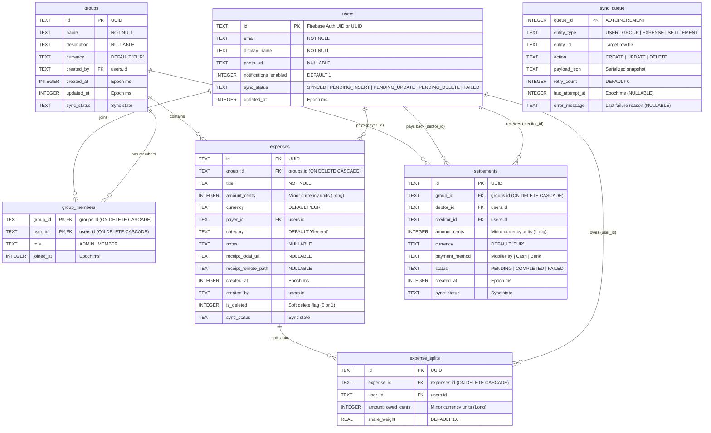
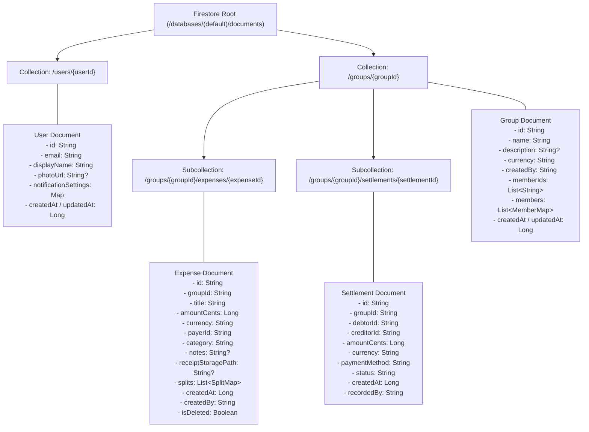
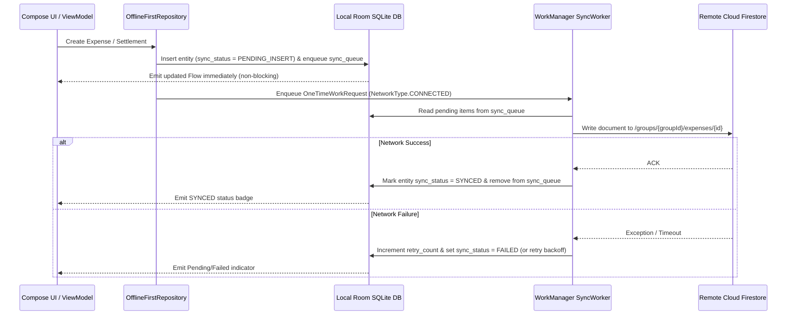

# Database Schema Documentation

This document details the dual-layer database architecture for **"Get Your Money Up Not Your Funny Up"**:
- **Local Database (Android Room / SQLite)**: Primary offline-first source of truth for the UI, enforcing relational integrity and queueing unsynced operations.
  - Draw.io diagram: [`docs/local_database_schema.drawio.xml`](file:///e:/Documents/GitHub/Mobile-Software-Development-GetYourMoneyUpNotYourFunnyUp/docs/local_database_schema.drawio.xml)
- **Remote Database (Cloud Firestore)**: Cloud persistence and real-time multi-user synchronization engine.
  - Draw.io diagram: [`docs/remote_database_schema.drawio.xml`](file:///e:/Documents/GitHub/Mobile-Software-Development-GetYourMoneyUpNotYourFunnyUp/docs/remote_database_schema.drawio.xml)

---

## 1. Local SQLite / Room Relational Schema

The local database consists of 7 relational tables designed for offline resilience, transactional integrity, and WorkManager synchronization.

---

## 2. Remote Cloud Firestore Document Hierarchy

Firestore uses a hierarchical document-subcollection model under `/groups/{groupId}` so security rules can validate group membership in a single lookup (`request.auth.uid in get(/databases/$(database)/documents/groups/$(groupId)).data.memberIds`).

---

## 3. Synchronization & Offline-First Data Flow

